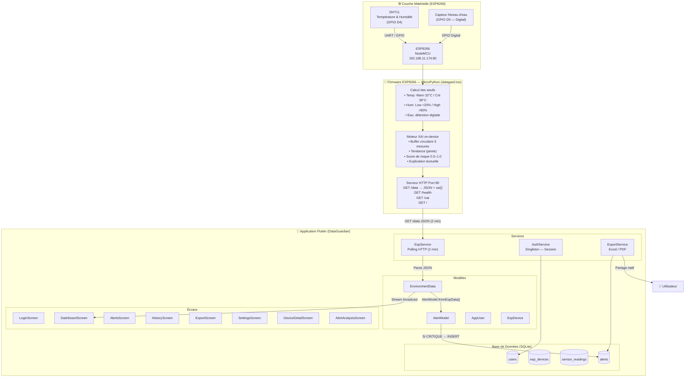
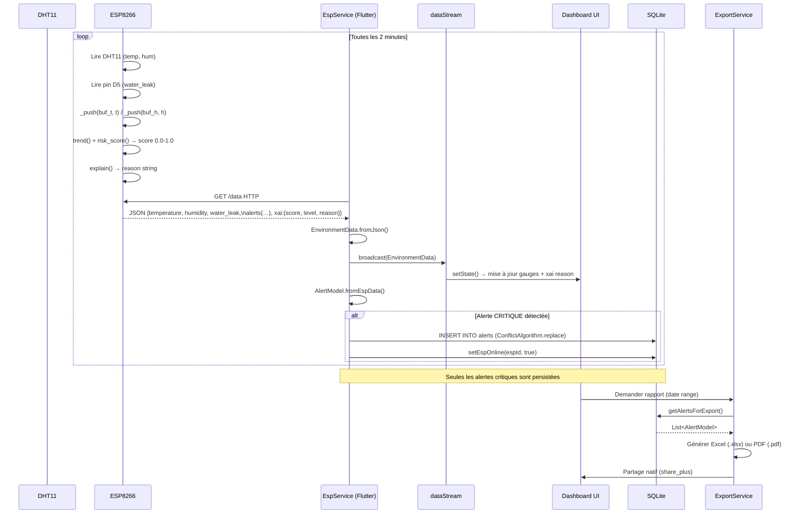
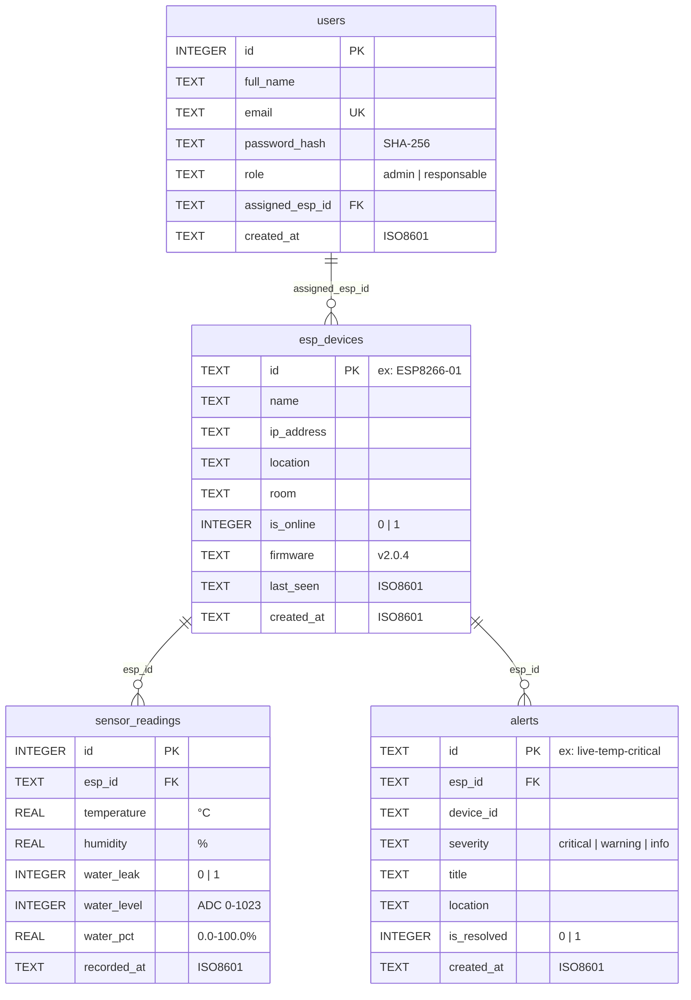
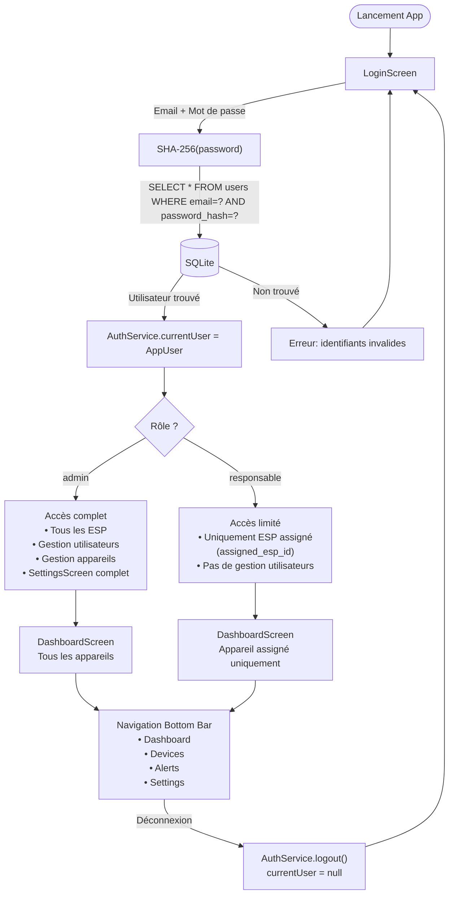
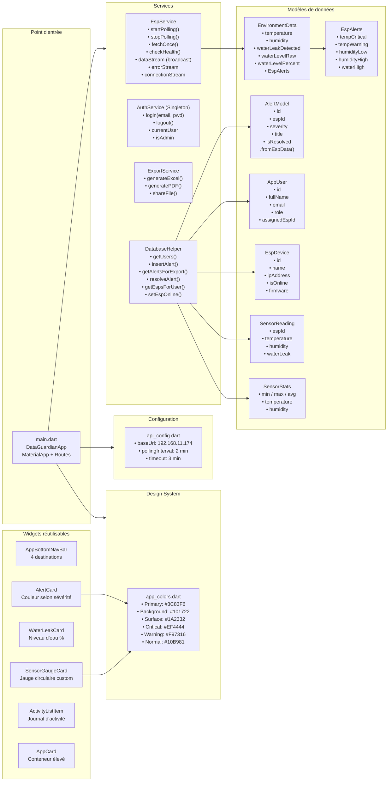
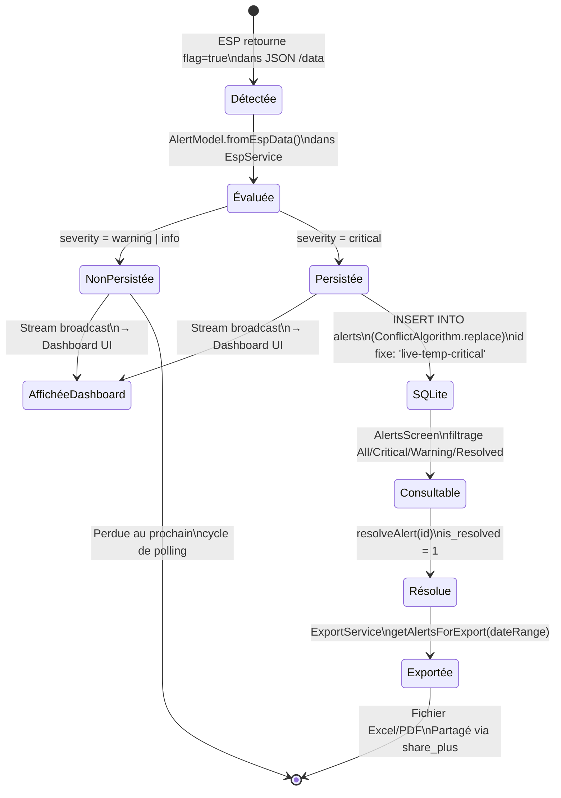
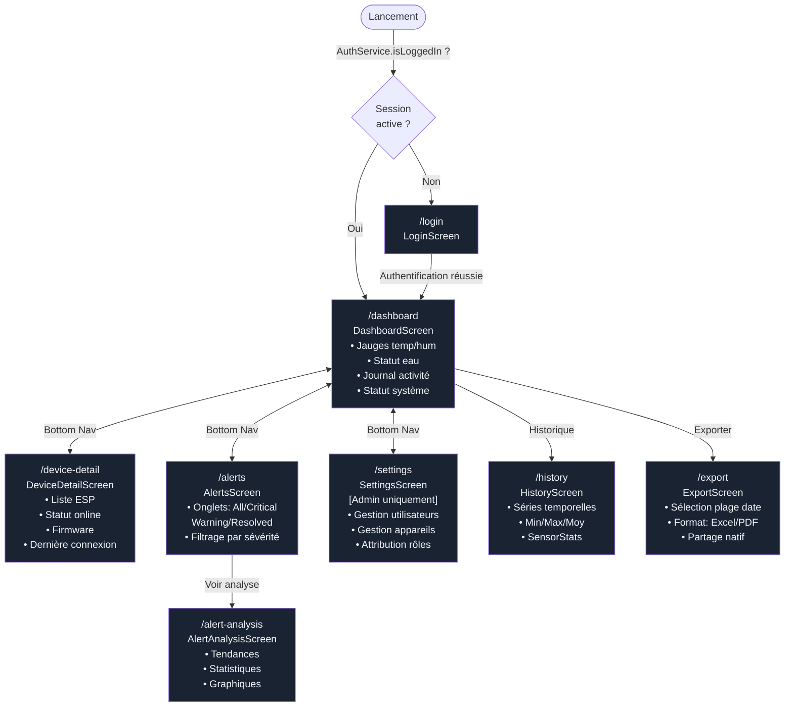
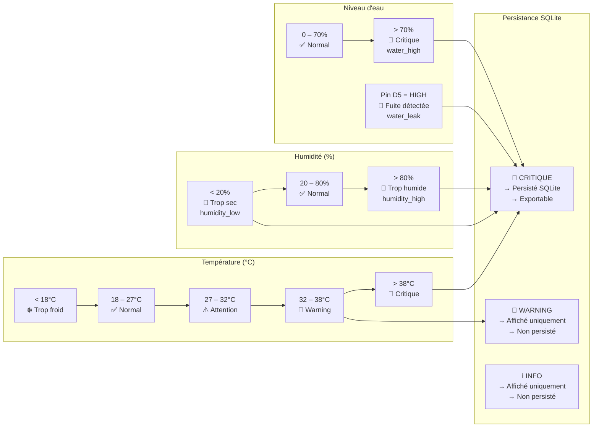
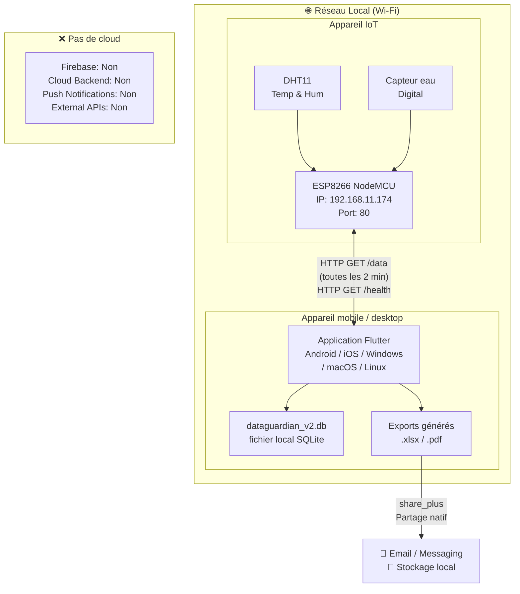

# DataGuardian IoT — Architecture Détaillée

## 1. Vue d'ensemble du système



---

## 2. Flux de données complet (Data Flow)



---

## 3. Architecture de la base de données SQLite



---

## 4. Flux d'authentification et contrôle d'accès



---

## 5. Architecture des composants Flutter



---

## 6. Firmware ESP8266 — MicroPython + XAI

```mermaid
flowchart TD
    BOOT([Démarrage ESP8266\nMicroPython]) --> WIFI["connect_wifi()\nSSID + password"]
    WIFI -->|"OK"| HTTP_START["socket.bind port 80\nsrv.listen(3)"]
    WIFI -->|"40 tentatives"| RETRY["Retry loop\n× 40 × 0.5s"]
    RETRY --> WIFI

    HTTP_START --> LOOP{conn, _ =\nsrv.accept()}

    LOOP -->|"GET /health"| HEALTH_RESP['{"status":"ok"}']
    LOOP -->|"GET /xai"| XAI_ONLY["ujson.dumps(xai)"]
    LOOP -->|"GET /"| HTML_RESP["Page HTML\nT / H / score / reason"]
    LOOP -->|"GET /data"| READ

    READ["read()\nsensor.measure()\nwater.value()"] --> PUSH["_push(buf_t, t)\n_push(buf_h, h)"]

    PUSH --> TREND["_trend(buf)\n= (last - first) / n"]
    PUSH --> SCORE

    TREND --> SCORE["risk_score()\n0.40×T + 0.20×H\n+ 0.20×eau + 0.20×tendance"]

    SCORE --> EXPLAIN["explain()\nif t > CRITICAL → 'T=X CRITIQUE'\nif trend > 0.5 → 'hausse +X/cycle'\nif t>warn & h>70 → 'condensation'\n→ reason string"]

    EXPLAIN --> BUILD["Construire JSON\n{temperature, humidity,\nwater_leak, device_id,\nalerts{…},\nxai:{score, level, reason}}"]

    BUILD --> CORS["sendall(HDR_JSON + body)\nAccess-Control-Allow-Origin: *"]
    CORS --> GC["gc.collect()"]
    GC --> LOOP
    HEALTH_RESP --> LOOP
    XAI_ONLY --> LOOP
    HTML_RESP --> LOOP
```

---

## 7. Cycle de vie des alertes



---

## 8. Structure de navigation des écrans



---

## 9. Moteur XAI embarqué — pipeline complet

```mermaid
flowchart LR
    subgraph BUFFER["Buffer circulaire (WINDOW=5)"]
        B1["buf_t\n[t-4, t-3, t-2, t-1, t]"]
        B2["buf_h\n[h-4, h-3, h-2, h-1, h]"]
    end

    subgraph FEATURES["Extraction de features"]
        TR_T["_trend(buf_t)\n= (t - t-4) / 5\n→ pente °C/cycle"]
        TR_H["_trend(buf_h)\n→ pente %/cycle"]
        ZS["_zscore(val, buf)\n= (val - mean) / std\n→ anomalie si |z| >= 2"]
        NM["_norm(val, lo, hi)\n→ 0.0 – 1.0"]
    end

    subgraph SCORE["Score de risque"]
        RS["risk_score()\n0.40 × norm(T, 32, 42)\n+ 0.20 × norm(H, écarts)\n+ 0.20 × water\n+ 0.20 × norm(trend_t, 0, 2)\n────────────────\n→ score 0.0 – 1.0"]
        LV["level\nscore >= 0.7 → critique\nscore >= 0.4 → warning\nscore  < 0.4 → ok"]
    end

    subgraph EXPLAIN["Génération explication"]
        EX["explain()\nRègles ordonnées par priorité:\n1. T > CRITICAL → 'T=X CRITIQUE (+Y/seuil)'\n2. T > WARNING  → 'T=X avertissement'\n3. trend_t > 0.5 → 'hausse +X/cycle'\n4. H < HUM_LOW  → 'H=X trop sec'\n5. H > HUM_HIGH → 'H=X trop humide'\n6. water = 1    → 'FUITE detectee'\n7. T>warn & H>70 → 'condensation'\n→ join(parts, ', ')"]
    end

    subgraph OUTPUT["Sortie JSON /data"]
        OUT['"xai": {\n  "score": 0.72,\n  "level": "warning",\n  "reason": "T=35C avertissement,\n   hausse +1.2/cycle"\n}']
    end

    BUFFER --> FEATURES
    FEATURES --> SCORE
    RS --> LV
    LV --> EXPLAIN
    SCORE --> EXPLAIN
    EXPLAIN --> OUTPUT
```

---

## 10. Seuils et niveaux d'alerte



---

## 11. Déploiement et infrastructure réseau



---

> **Résumé technique :**
> DataGuardian IoT est une application Flutter autonome (sans cloud) qui interroge périodiquement un ESP8266 via HTTP REST sur le réseau local. Le firmware est écrit en **MicroPython** et embarque un moteur **Explainable AI on-device** : fenêtre glissante de 5 mesures, calcul de tendance, score de risque pondéré (0.0–1.0) et génération d'une explication textuelle — le tout sans appel externe. Le champ `xai` est retourné directement dans la réponse `/data`. Seules les alertes critiques sont persistées dans SQLite. L'application supporte deux rôles (admin / responsable) et permet l'export des rapports en Excel ou PDF.
